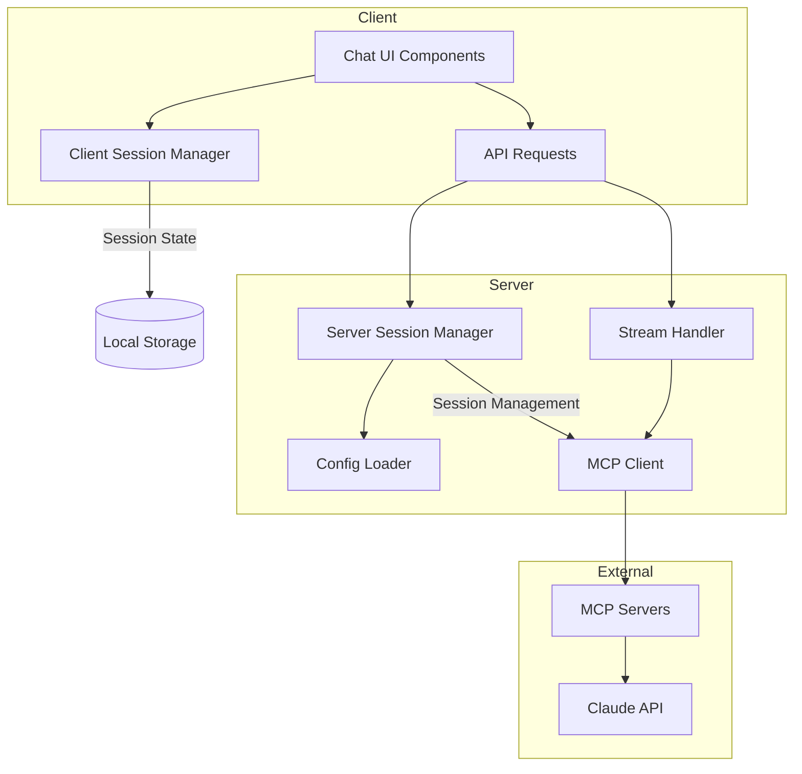

# Codebase Analysis and Refactoring Suggestions

## Summary

This codebase implements a chat application that integrates with the Model Context Protocol (MCP) to provide AI assistant capabilities with tool integration. The application allows users to interact with Claude AI models through a modern chat interface, with support for streaming responses, tool execution, and message history management. It uses Next.js for the frontend and backend, with React components for the UI and server-side API routes for handling requests to the AI model.

## Architecture Analysis

The application follows a client-server architecture with clear separation of concerns:

### Components

1. **Frontend (Client)**

   - **Chat UI Components**: Provides the user interface for the chat application.
   - **Client Session Manager**: Manages chat sessions in the browser's local storage.
   - **Message Management**: Handles message display, formatting, and history.

2. **Backend (Server)**

   - **API Routes**: Handles requests to the AI model and streams responses back to the client.
   - **Server Session Manager**: Manages sessions on the server side, interfacing with the MCP client.
   - **Config Loader**: Loads and validates configuration for the MCP client.

3. **External Dependencies**
   - **MCP Client**: Connects to MCP servers for tool discovery and execution.
   - **MCP Servers**: Provides tool functionality (filesystem, terminal, etc.).
   - **Claude API**: The underlying AI model that generates responses.

### Architecture Diagram

## Best Practices Evaluation

### Strengths

1. **Separation of Concerns**: The codebase has good separation between client and server functionality, with clear boundaries between components.
2. **Type Safety**: The application uses TypeScript throughout, with well-defined interfaces and types.
3. **Error Handling**: There is consistent error handling in many parts of the codebase, with appropriate logging.
4. **Testing**: The presence of test files indicates a focus on testability.
5. **Configuration Management**: The application has a flexible configuration system that can load from different sources.
6. **Modern Architecture**: Uses Next.js App Router, React server components, and other modern patterns.

### Areas for Improvement

1. **Code Organization**: Some files are quite long (e.g., ChatContainer.tsx at 347 lines), which could be broken down into smaller, more focused components.
2. **Error Handling Consistency**: While there is error handling, it's not consistent across all parts of the application.
3. **Logging**: There are many console.log statements that should be replaced with a proper logging system.
4. **Documentation**: While there are comments, more comprehensive documentation would help with maintainability.
5. **Duplicate Logic**: There appears to be some duplication between client and server session management.
6. **Testing Coverage**: While tests exist, they may not cover all critical paths.

## Refactoring Suggestions

### 1. Code Organization and Modularity

**Issue**: Some files are too large and have multiple responsibilities.

**Suggestion**: Break down large components into smaller, focused ones:

- Split `ChatContainer.tsx` into separate components for message management, session controls, and streaming functionality.
- Extract the message formatting and rendering logic from `AssistantMessage.tsx` into its own component.

### 2. Improved Error Handling

**Issue**: Error handling is not consistent across the application.

**Suggestion**: Implement a centralized error handling system:

- Create an error handling utility that standardizes error responses.
- Add proper error boundaries in React components to prevent UI crashes.
- Ensure all async operations have proper error handling with meaningful user feedback.

### 3. Better Logging

**Issue**: Many console.log statements scattered throughout the code.

**Suggestion**: Implement a proper logging system:

- Create a structured logging utility with different log levels (info, warn, error, debug).
- Make logging configurable based on environment (development, production).
- Consider integrating with a monitoring service for production environments.

### 4. Enhanced Type Safety

**Issue**: Some types could be more strictly defined or centralized.

**Suggestion**: Improve type definitions:

- Create a centralized `types.ts` file for shared interfaces.
- Use more specific types instead of Record<string, any> where possible.
- Add stricter validation for external inputs, especially in API routes.

### 5. Unified Session Management

**Issue**: Duplication between client and server session management.

**Suggestion**: Refactor session management:

- Create a unified session management approach that works consistently between client and server.
- Consider using a more robust state management solution like React Context or a state management library.
- Implement server-side session persistence for better reliability.

### 6. Configuration Management

**Issue**: Configuration loading has fallbacks but could be more robust.

**Suggestion**: Enhance configuration system:

- Add schema validation for configuration files.
- Implement environment-specific configurations.
- Create a configuration UI for easier management of settings.

### 7. Performance Optimization

**Issue**: Potential performance bottlenecks in streaming and message rendering.

**Suggestion**: Optimize for performance:

- Implement virtualization for long message lists.
- Add pagination for message history to reduce initial load time.
- Optimize the streaming implementation to reduce memory usage.

### 8. Testing Improvements

**Issue**: Test coverage may not be comprehensive.

**Suggestion**: Enhance testing:

- Increase test coverage, especially for critical paths.
- Add integration tests that verify the complete flow from UI to API to MCP.
- Implement end-to-end tests using tools like Playwright or Cypress.

## Conclusion

The codebase is well-structured and follows many modern best practices, but there are opportunities for improvement in organization, error handling, and performance. The suggested refactorings would enhance maintainability, reliability, and user experience while ensuring the application can scale as needed. The application's architecture is sound, with clear separation between client and server responsibilities, making it a good foundation for future enhancements.
